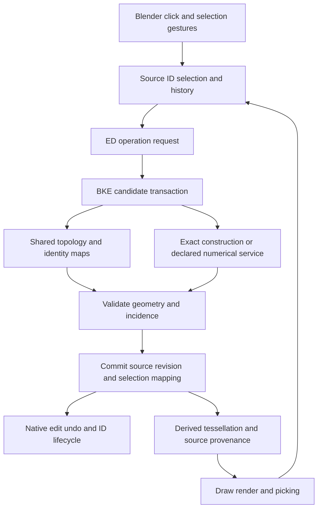

# NURBS editing architecture decision and storage experiment

Status: **candidate architecture; promotion depends on the gates below**.
Baseline: `355a9ae11d7e39d75f1341322a70776fb206a6bc`.
This is Blender work. The older study's classiCAD contracts are not requirements.

Current verified foundation: 126 kernel/integration tests, a complete Blender build and
the documented application regressions pass. Native object evaluation retains
source snapshots and produces a derived display Mesh with stable source
provenance. Actual saved-source sheet/hole/cylinder viewport captures have been
inspected; rational source normals produce smooth cylinder shading while sharp
joins between faces remain sharp. The source fixture file is unchanged.
Shared component selection normalization is implemented, built and tested,
including 5,390 comparisons with actual BMesh selection flushing. Native
topology-vertex overlays, X-Ray click/box selection, Select All and viewport
selection undo/redo are now built and tested; an actual screenshot has been
inspected. Fit-point editing, linked selection, edge/face picking and modal
geometry transforms still gate broader editing. This is not completion of Stage 1
or replacement of the production prototype's operators.

## Decision

Build a dedicated NURBS geometry/topology kernel in BKE. Keep its storage
independent of editors, tessellation, and the legacy `Nurb` control-net layout.
Test an optional, owned payload on the existing `Curve` ID as the first native
storage candidate. Retain Surface/Curve objects and Blender's ID lifecycle while
testing that candidate. Do not select a new public object type or RNA element
API before the experiment establishes ownership and source identity.

The candidate is not an extension of the four corner IDs into a larger array.
An edge must own one geometry reference; all incident face uses reference that
edge. The current patch IDs are migration input and regression fixtures.

`displist.cc` also records a longer-term intention to replace legacy Curve
evaluation with modern curve data. The kernel must therefore take `NurbsGeometry`
as input, with Curve ownership isolated to lifecycle/adapters. If the host owner
changes, the payload and local IDs must migrate without rewriting algorithms.

Do not change production extrusion to use this payload until copy/free,
read/write, edit undo, evaluation, picking, and transform gates pass. Merely
adding a pointer to DNA does not meet Stage 1.

## Alternatives checked against this source tree

| Candidate | Evidence | Decision |
|---|---|---|
| Extend `Nurb` as the shared model | `DNA_curve_types.h`: independent float control nets and knots; four corner/edge IDs. `curve_topology.cc` synchronizes copies. `editcurve.cc` owns extrusion construction. | Keep the prototype as migration input. Independent patch corners cannot own a single shared edge curve, per-face p-curves, arbitrary loops, and fit handles. Expanding this layout would spread geometric reconciliation across its callers. |
| Use `CurvesGeometry` as the owner | `DNA_curves_types.h`, `BKE_curves.hh`, `curves.cc`: modern attributes, custom knots, caches, serialization; one dimensional curve offsets and float positions/evaluation. | Reuse patterns and suitable evaluation utilities. Adding tensor surfaces, trims, topology domains, and model precision would still be a new geometry system. Hair curves must preserve their existing contract. The old comment saying custom knots are unsupported is stale even in this source tree. |
| Dedicated payload on `Curve` | `curve.cc` registers native copy/free/read/write; Surface objects already use this ID. `displist.cc` isolates Surface evaluation. `editcurve_undo.cc` isolates edit snapshots. | Preferred storage experiment. Reuses object/collection/material/library ownership without forcing authoritative geometry into `Nurb`. Requires deliberate routing and protection against legacy mutations; those are gates, not assumed benefits. |
| New ID and object type immediately | `BKE_idtype.hh`, object evaluation dispatch, mode dispatch, selection, draw, RNA and native file registration all require extension. | Possible later. Adds host integration before proving the geometry boundary and does not solve geometry or numerical robustness. Reconsider if Curve ownership requires pervasive special cases. |
| BMesh with NURBS attributes | `bmesh_class.hh`: float `BMVert::co`, polygon loops; `USE_BMESH_HOLES` disabled. BMesh geometric operators use polygon normals, triangles and straight edges. | Behavioral and incidence reference. A mesh custom-data layer cannot make its geometry operators a NURBS kernel. Do not make BMesh the source of truth. |

## Model and ownership

Persistent storage needs distinct records for:

* Vertices: stable identity, model position and tolerance, incident edges derived
  from references. Valence is unrestricted.
* Edges: identity, two vertex references, one exact 3D rational spline and its
  parameter interval. Wire edges and edges with more than two face uses are legal.
* Faces: identity, rational tensor support, orientation and oriented boundary loops.
  A hole is an inner loop, not a missing display triangle.
* Edge uses: identity, shared edge reference, orientation and a p-curve in the
  face's support parameter space. A seam may use the same edge twice on one face
  with different p-curves. Parameter correspondence and tolerance belong here.
* Shell/body uses: stable oriented incidence when needed. Solid eligibility is
  separate from basic topology validity; open sheets and wires remain editable.
* Fit handles: separate identity and interpolation/analytic constraints on a
  curve. These are neither control coefficients nor topology vertices.
  The user-facing NURBS workflow edits fit points only. Control coefficients
  and rational weights are internal geometry data; no CV editing mode is planned.

Use explicit knots, orders, rational weights and parameter intervals. Preserve
component curves when joining. Double model coordinates, weights and knots are
the storage candidate; derived GPU/mesh coordinates may be float. Promotion must
test every numeric boundary: double storage alone is not a robustness guarantee.

IDs are local to an owning geometry, nonzero and persistent. Allocate from a
monotonic counter; do not derive identity from coordinates, array indices, memory
addresses or display triangles. Duplicating an entire ID can preserve internal
identities because its owner changes. Duplicating inside an owner must allocate
new IDs and return reference maps. Moving geometry does not allocate identity.

The native owner frees all nested data and deep-copies owned storage. References
within the payload use IDs, not raw cross-patch pointers. Runtime incidence,
lookup and tessellation caches are derived and invalidated by revision; they
are not serialized as another authority. Blender ID references remain in normal
ID traversal. Do not add external object references inside a new payload without
extending `foreach_id` and library handling.

Legacy files retain their `Nurb` data until a validated migration is requested
or designed. A missing payload reads as null. Never infer connectivity through
distance welding. Prototype migration can preserve its explicit IDs, but must
reject inconsistent repeated IDs or unsupported tagged supports atomically.

Before production activation, enforce one authority per owner: payload present
means legacy Nurb arrays cannot also be writable source. Migration must commit
once with undo and identity maps. Unsupported legacy operators/RNA mutations
must report their limitation rather than mutate an empty/stale alternate model.
Do not fall back to a display mesh or legacy approximation when payload
validation fails. These activation rules are not yet enforced by the storage
experiment, which has no production creation path.

## Shared editing pipeline

ED owns context, poll, options, reports and modal choreography. It sends selected
source IDs to BKE. It does not construct support geometry or count patch-local
selected CVs to guess which edge the user selected.

BKE owns incidence, mutation, geometry and validation. Operations construct a
candidate, validate it, then commit once. Results include old-to-new maps,
created/deleted IDs, affected domains, exactness classification and numerical
diagnostics. On failure, geometry, selection, history and revision remain
unchanged. A runtime adjacency index should serve linked selection, boundaries,
region classification, transform propagation, and later split/delete/duplicate.

Selection is a set of source component IDs plus active/history data, with explicit
Vertex/Edge/Face domains. Fit handles are a distinct editing domain; control
coefficients are internal and are not selectable editing handles.
Click, box, lasso, circle and linked produce the same set when they target the
same components. Flush selection according to Blender component-mode rules.
Gesture algorithms must not each invent connectivity or geometric ownership.

Transform reuses Blender's modal interaction. Adapt original double source
geometry plus transform deltas; never round-trip untouched coordinates through
float `TransDataBasic::loc`. Complete support affine transforms are exact
constructions. A partially selected curved support needs a deformation contract
and constraints; duplicating a moved endpoint onto other patches does not solve
that problem. Cancel restores original source data and selection.

The numeric-input parser already evaluates into double, but `numinput.cc`
casts the unit-scaled result into `NumInput::val` (float), and `applyNumInput`
exports floats. `val_no_units` is double but is not the converted model-space
value. Reuse the parser and modal interaction with a proven double result
channel for the new source adapter; reading that raw field or casting the final
float back to double does not establish numeric-input precision. Pivots,
orientations and snapping have their own boundaries to test.

Evaluation derives geometry with provenance back to source vertex/edge/face IDs.
Shared boundaries tessellate from the same edge and coherent sampling, not from
independent patch tessellation. Picking may use display acceleration, but resolves
to source IDs. Changing resolution must not change logical selection. Trims and
analytic normals feed viewport and render from the same source. Legacy modifiers
must declare whether they preserve NURBS, evaluate a mesh, or require explicit
conversion; applying a mesh result must never silently replace source NURBS.

## Operation contracts

### First exact editing slice

Translating a source edge curve `C(u)` by displacement `d` gives the ruled
support `S(u,v) = C(u) + v*d`. Its U knots/order/weights come from the exact
source curve; V has degree one. The two control-coefficient rows differ by
`d`, and the weights are repeated, not refitted. A trimmed edge interval stays
an explicit support trim; it does not justify clamping or rebuilding its knots.
Connector endpoints must use the edge interval endpoints, which need not be
the first/last control coefficient. The existing source edge is shared with
the new face; translated edges/vertices get fresh IDs and complete maps.
At zero displacement the ruled support is singular and the new identities can
be coincident. That is an editable intermediate state, not a reason to weld
identities, refuse modal extrusion or claim a valid solid. Undefined normals
and solid-operation eligibility need separate reporting. Match Blender's
extrusion-versus-transform cancellation behavior explicitly in the modal tests.

Face-region construction first copies the selected closure with shared
dependencies copied once, then translates its cap supports and shared curves.
Walls come from the region boundary uses, not independent per-face guesses.
Repeated uses of one edge at a periodic seam must not generate a false wall.
Hole boundaries, face orientation, selected/unselected incidence and non-manifold
states require explicit fixtures before claiming general region parity.

Blender's `bmo_extrude_face_region_exec` does not unconditionally keep originals:
unless `use_keep_orig` is set, an incident unselected face triggers removal of
the input region. When originals are kept, their orientation can be flipped.
The new service must reproduce these topology/selection rules on matching
fixtures; always retaining an old cap is the diagnosed prototype error.
This is a behavior reference, not permission to reuse polygon geometry code.

After extrusion is committed, moving a cap again is a separate deformation
operation. Shared edge identity alone does not solve the incident support
geometry. Whole-support affine movement is exact; partial support movement
needs a proven exact case or a reported solver/tolerance contract. Do not
claim arbitrary vertex movement is implemented because a ruled extrusion is.

### Integration points to prove before activation

| Source boundary | Required adapter/gate |
|---|---|
| `blenkernel/intern/curve.cc` | Own, copy, free and serialize the payload. Keep owner-specific code out of geometry algorithms. Missing payload in old files remains null. |
| `editors/curve/editcurve.cc` edit-data entry/load/free | An owned edit snapshot and explicit flush to the ID; do not use a generated legacy control net as editable source. Shape-key and animation compatibility need deliberate handling. |
| `editors/curve/editcurve_undo.cc` | Snapshot source geometry, selection, active/history state and identity counter; restoring only legacy Nurb arrays is insufficient. Object memfile serialization is a different check from edit undo. |
| `blenkernel/intern/displist.cc`, `object_update.cc` | Dedicated source evaluation dispatch. Existing Surface evaluation only reads legacy Nurb lists. New payloads must not be exposed before this works. |
| `draw/intern/draw_cache_impl_curve.cc`, overlays | New component batches and source-ID provenance; existing edit cages are CV batches. Cache lifetime and invalidation remain Blender-owned. |
| `editors/space_view3d/view3d_select.cc`, curve picking | Central source-domain selection adapter. Mesh GPU selection buffers and legacy projected CV selection cannot simply be re-labeled as NURBS face picking. |
| `editors/transform/transform_convert_curve.cc`, `transform.hh` | Dedicated source adapter with one transform target per source identity. Current float locations/pivots/numeric input and duplicate patch corners do not meet the precision or component contract. |
| `blenkernel/intern/curve.cc` transform/bounds/material helpers, object Apply Transform | Route complete-support transforms, bounds and per-face metadata to the payload. Object transform application must not clear an object matrix while leaving its source geometry untouched. P-curves remain in support parameters during affine geometry transforms. |
| `BKE_geometry_set.hh`, Geometry Nodes and modifiers | No native NURBS body component exists in the current component enum. Design that integration explicitly; a mesh component is derived output. Source ownership does not automatically establish node/modifier parity. |

The first experiment implements ownership, structural validation and scalar
double source evaluation. A cylinder/cone fixture checks their shared rational
edge against both p-curves at sampled parameters; this is not a general geometric
validity certificate. The tagged prototype importer preserves explicit component
IDs and parameterized geometry, with rational p-curves for boundary correspondence.
A shared component-copy service preserves internal incidence and returns fresh
IDs for all copied dependencies. These services do not activate an editing path
or migrate the full legacy attribute/selection contract.
A shared ruled-edge constructor now returns an owned candidate and source-to-cap,
vertex-to-rail and edge-to-face maps. It reuses component-closure copying for fresh
cap IDs and retains real source-edge identity. Adjacent selected edges share cap
vertices and rails; positive-weight rational curves retain their basis/domain,
including trimmed edge intervals. A clamped rational-circle seam is tested.
Explicit translation roundoff budgets and source endpoint discrepancy reports
are part of this service's contract; zero budget requires exact coefficient
addition. No UI tolerance default, general regularity certificate, implicit fit,
solid orientation or smoothness constraint is supplied. The constructor feeds
the shared editor commit path in integration tests and survives native file,
memfile and generic undo transition tests. It is not yet an editor extrusion path.
Whole-source affine transformation is implemented in `BKE_nurbs_transform.hh`.
3D coefficients, supports and vertices transform once; p-curves stay in surface
parameters. IDs, basis/weights/domains and stored selection remain unchanged.
Explicit coefficient-roundoff budgets and conservative tolerance propagation are
returned to the caller. Repeated rotations use a near-rigid Gram bound instead
of unnecessarily inflating model tolerances. Singular transforms are allowed;
reflection retains orientation flags, with any corrective flip a separate edit.
This is not the modal/partial-support transform adapter. Tests include native
undo/memfile use of the service, exact rational reference checks and tiny-value
hardware mode rejection. Scalar source evaluation checks those modes too.
Canonical boundary sampling is implemented in `BKE_nurbs_evaluate.hh` as a
derived-only service. Each edge is evaluated once at shared parameters, including
incident p-curve knots; face uses retain separate UVs and source provenance.
Source vertex IDs join endpoints without coordinate welding. Measured endpoint
and edge/support discrepancies are checked against declared tolerances plus an
explicit caller allowance, reported, and never written back to source. Tests
include holes, a rational shared arc with different support parameterizations,
a circle seam, non-manifold/collapsed states, coincident identities and retained
live-source evaluation after owner destruction. Positive weights and continuous
parameterizations are initial restrictions. This is uniform boundary preview,
not a geometric approximation certificate, UV trim validator, filled surface
tessellator or viewport/depsgraph adapter. See `evaluation_and_snapshots.md`.
An owned kernel edit state supports atomic commits and independent source and
selection snapshots. Its suite now passes twenty-eight tests: eleven state/storage/read tests
and seventeen owner/undo/flush/editor/evaluation integration tests. Real Curve callbacks and adjacent
Curve steps through Blender's generic undo stack are tested, including a real
memfile root and ID store/resolve. Geometry/ID-counter and selection active/history
restoration are checked together. A further fixture crosses Curve edit steps,
Edit Mode exit and object-mode memfiles through the generic stack. It runs
repeated undo/redo with ID reuse and a full memfile barrier, reacquiring all
source pointers after decode. It uses native window/workspace/screen context
without a GHOST window. This fixture now starts from a constructed ruled sheet
and checks its face and shared edge uses through each reload. Viewport Ctrl-Z
and ordinary mode entry remain separate checks. No production mode entry
activates the new source.
The selection validator checks references, active state and history. A shared
V/E/F bulk selection flush service is implemented, built and tested.
It follows BMesh flushing with an explicit Down flag; the default
BMesh flush is upward only because its individual selection setters already
propagate downward. All seven mode combinations are compared against actual
BMesh on planar fixtures. Holes, seam uses, non-manifold incidence, history and
atomic commits have native-specific fixtures. This is not mode conversion,
visibility handling or a viewport gesture adapter; no UI parity is claimed.
Full geometry
copies and a single conservative runtime revision are correctness experiments,
not a settled per-gesture performance design. Later revision domains and
incremental transactions must preserve the same atomic failure contract.
Persistent selection conversion is implemented in `BKE_nurbs_selection.hh`.
The ID payload owns typed selection/history arrays and active state. Live edit
geometry clears that stored copy and keeps selection in `SelectionState`;
snapshots reject a second stored authority. Flush constructs and validates the
complete owner candidate before replacing its old payload. The same selection
validator checks runtime and stored references. Native file and memfile tests
restore V/E/F IDs, active/history and edit re-entry; ID copies own independent
arrays. Gesture normalization and production mode entry remain separate gates.
The shared `ed::nurbs::edit_commit` adapter now delegates candidate validation
and replacement to BKE, then marks Curve/Main flush flags, dependency-graph
recalc and an owner notification only on success. Rejection leaves these
states unchanged. The supplied Main owns notification routing; a global Main is
not required. Selection-only changes currently invalidate conservatively too.
The adapter does not push operator/modal undo. The generic undo-stack fixture
uses it; directly committing the isolated `EditData` object still does not
notify its Curve owner or the dependency graph.

Viewport/trimmed evaluation, picking and full native edit undo remain
separate gates. The original `ED_curve_editnurb_load` had a void return, and
object-mode exit could free edit data after a failed flush. The current patch
adds an explicit failure result through native Curve load, generic edit-mode
load/exit and editor flush. Save, startup/recovery/autosave, render, scene-copy,
exports and memfile encode check that result before consuming the ID cache.
Failed flushes retain live source and dirty flags; save callbacks and autosave
retry bookkeeping still run. The checked-flush checkpoint builds and its failure/retry tests pass; see the
current audit for exact commands and application regression coverage.
The generic undo stack also stops if its prerequisite memfile cannot encode;
this does not make failed undo pushes transactional with respect to an already
trimmed redo branch. Undo callback failure propagation and legacy/new-source
migration across memfile steps still need explicit checks. Cache revisions are
valid within one edit lifetime; exit/re-entry must invalidate caches even if a new edit state starts
its revision counter at one.

Shell/body uses, fit-handle constraints, periodic
representation policy and attribute domains are not settled by the initial DNA
records. Do not expose those records as a stable public API yet.

| Class | Examples | Required contract |
|---|---|---|
| Same interaction and topology | Selection, hide/reveal, traversal, copy/delete/split/separate, complete affine transforms | Shared graph, identity maps, attribute propagation, undo and selection behavior. Partial curved support movement is excluded from the complete affine claim. |
| NURBS-specific exact geometry | Translational edge extrusion, translated caps with ruled walls, rational arcs, compatible support partitions | Exact supports, weights/knots/domains, edge and p-curve correspondence, orientation. Ctrl+R makes topology; knot insertion is separate. |
| Restricted or numerical | Arbitrary connected deformation, inset, offsets, fillets, general bridge/fill, intersections and booleans | Explicit construction, tolerance, continuity targets, measured versus certified deviation, atomic rejection. Do not select an external kernel before comparing it. |
| Representation-specific | Mesh remesh/subdivision, display triangulation hints, mesh-only consumers | Explicit mesh result or a separately defined NURBS operation. Same-support triangular trim partitions can preserve NURBS exactly; that is different from polygon triangulation. |

The 358-row parity map remains a proposed intent inventory. It is not an
implementation checklist already passed. Conflicting older recommendations
(automatic closed solids, geodesic inset by default, treating polygon primitive
segments as preview density, knot removal as unsubdivide) must be reconciled
against Blender behavior and explicit NURBS semantics before porting those tools.

## Storage experiment and promotion gates

1. Implement isolated DNA/BKE storage and native owner lifecycle. Test deep copy,
   free, valid explicit references and native serialization without public RNA or
   production operator changes. Keep this a reviewable architecture experiment.
2. Import the tagged line/patch prototype without coordinate welding. Preserve
   source IDs, degree, knots, weights and intervals; reject inconsistencies.
   Build an incidence index and test arbitrary valence, wires and shared edges.
3. Prove source evaluation, stable picking and native undo with the candidate.
   Include a rational curved edge shared by two faces and a face with a hole.
   A line and a cube are insufficient evidence for general curved topology.
4. Choose or revise the owner from those results. Only then route selection,
   transforms and extrusion through the shared kernel and retire corresponding
   legacy prototype logic.

Stages 2–7 of the handoff remain required. This experiment is not completion of
Stage 1, and does not justify broad operator ports before its gates pass.

The [geometry-service feasibility review](kernel_service_feasibility.md) records
new primary-source evidence, including OCCT 8.0's graph model, that must be
evaluated before expanding native numerical/topology services broadly. The
small ownership experiment does not preselect an external kernel or freeze the
runtime graph implementation.

`EditData` now publishes immutable states and offers retained `ReadSnapshot`
handles with synchronized acquisition. Geometry, selection, counter and revision
stay together across commits and owner destruction. Expected-state token commits
reject a previous edit lifetime even if its numeric revision matches. Borrowed
access remains serialized editor-thread access. The current owner experiment has
one editor writer; retained-data lifetime does not establish safe acquisition
through a freed edit container or complete depsgraph/scene lifetime handling.
The [evaluation design](evaluation_and_snapshots.md) records the next COW,
preview-provenance and source-picking gates. Functional concurrent-read tests pass;
ThreadSanitizer remains unverified. Native COW, object display and the restricted
topology-vertex edit overlay now have integration tests; this does not establish
every drawing/scene lifetime contract.

## Python integration direction

The user expects Python access to the new editing system. Both context operators
and structured data operations must call the same C++ kernel services and common
owner commit path. Fit points are the intended curve-editing handles. Python
must not expose mutable borrowed coefficient/element pointers that survive a
source replacement; transactions and retained read views need explicit lifetime
and stale-state checks. Persistent component IDs are not array indices.
Public element bindings remain a promotion gate until identities, fit-point
semantics and mutation contracts settle. Read-only `Curve.is_native_nurbs` owner
metadata and existing `bpy.ops` selection routes are implemented. Native element
bindings and a public native geometry creator are not implemented yet.

## Product decisions to resolve through examples

* Exact circle/arc fit-point dragging: remain analytic and solve center/radius,
  slide on the fixed curve, or explicitly become freeform. Asked before choosing.
* Partial curved edge/face movement: local deformation scope, anchored fit points
  and continuity constraints. Show fixtures before setting the default.
* Numerical policy: document units, absolute/relative tolerance, and whether an
  operation may offer a reported fitted result or requires explicit opt-in.
* Inset/slide on curved supports: support parameter distance, arc length or a
  surface metric have different visible results. Keep their controls explicit.

Do not ask the user to make implementation ownership choices that source
investigation and the experiment can answer.
