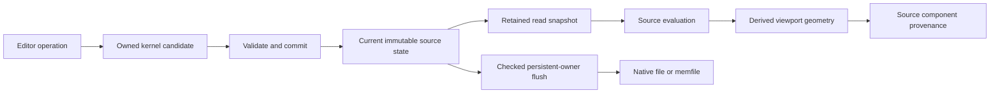

# Native NURBS evaluation and source snapshots

Status: retained source snapshots, canonical boundary sampling, filled preview,
source normals and native object evaluation are implemented, built and tested.
Actual object-mode and native selection viewport captures have been inspected.
Source topology-vertex overlays, X-Ray click/box selection and selection undo
are implemented for the initial surface subset. Fit-point editing, edge/face
picking, visible-only picking and geometry transforms remain integration work.
Exact checkpoint evidence is
recorded separately in `current_checkout_audit.md`.
This does not complete native modeling or select a numerical backend.

## Source reading

Edit Mode's live source is `EditData`, not the older cached
`Curve::nurbs_geometry` payload. That payload is synchronized for persistence by
the checked flush path. Evaluation must not accidentally draw the older cache.

The implemented immutable read snapshot retains geometry, selection, the ID
counter and runtime revision together. Acquisition must be synchronized with source commits;
readers then work without touching a mutable edit container. Retained snapshots survive subsequent commits, undo restoration, Edit Mode exit
and owner freeing. It owns only local geometry/state, with no borrowed Main or Blender ID
references. Materials, object transforms and scene context remain host-owned.

Borrowed geometry/index references remain valid only within their documented
lifetime. A retained read snapshot provides that lifetime for an index built
from its geometry. A raw revision number does not keep data alive. Revisions can
also restart after edit re-entry, so an asynchronous candidate needs an expected
source-state token, not just a numeric revision. A token from an earlier edit
lifetime must be rejected even if the new lifetime has the same revision number.
An owning read snapshot can serve as that token without using topology IDs or
memory addresses as persistent identity.

Acquiring a snapshot still requires the edit container to be alive. Retaining a
snapshot protects its contents, not future calls through a freed EditData
pointer. The native COW adapter must capture a read snapshot while host ownership
is valid, then hand that snapshot to workers. Scene/object/material lifetime and
changed world-space input context are separate host responsibilities.

The handoff candidate adds an owned `Curve::nurbs_eval_source` runtime wrapper.
The dependency graph captures it in `update_curve_edit_mode_pointers`, including
the existing fast path that refreshes edit pointers without recopying the ID.
Live Edit Mode supplies its retained immutable state; Object Mode supplies an
independent copy of the persistent geometry and stored selection. Copying an
evaluated Curve retains the same state token in an independent wrapper. A failed
native capture retains an error and no source; an evaluation client must report
that error rather than fall back to stale ID geometry or legacy splines.

The runtime wrapper is owned/freed by Curve, cleared from native serialization
and reset on read. Writable-owner validation rejects an evaluated lease before
examining borrowed edit pointers. Acquiring the original source still requires
Blender's host lifetime discipline. This change does not let arbitrary threads
access a destroyed Curve or EditNurb, and does not yet route display evaluation
to the captured source. Object-mode captures currently copy on each refresh;
no incremental cache/performance claim is made.

The first implementation can remain a single editor writer with synchronized
snapshot acquisition. Full candidate/undo copies are still correctness
experiments. Geometry/selection revision domains, incremental transactions and
selection-only geometry sharing are later performance work. Do not claim that
a read lease alone establishes complete depsgraph or render integration.

## Derived geometry and source identity

The preview is derived. It never writes fitted coefficients, triangulated data
or inferred connectivity back to the source graph.

| Preview data | Source association |
|---|---|
| Corner marker | Persistent topology vertex ID; fit constraints are a separate domain. |
| Sampled boundary curve | Edge ID and canonical edge parameter. |
| Face-local boundary use | Face/use ID and its own p-curve parameterization. |
| Interior point | Face ID and support UV. |
| Render triangle | Face ID, not a new editable face. |
| Render diagonal | Derived only; not an editable source edge. |

Evaluate each shared edge once at a common parameter sequence. All incident
face uses must use that sequence through their own p-curves. This prevents
face-local sampling from inventing duplicate shared boundaries. Source vertex
identity, not position equality, joins endpoint samples. Distinct coincident
vertices/edges remain distinct source components.

Check edge/support/p-curve agreement against the declared source tolerances and
report measured disagreement explicitly. Sampling is not a general geometric
certificate. Uniform preview resolution must not be described as a guaranteed
source approximation tolerance. Float display conversion also does not certify
source precision or change the authoritative doubles.

Blender's `BLI_delaunay_2d.hh` can triangulate sampled UV constraints and holes,
but it merges coincident/nearby input vertices and can create intersection
points. Its output identity cannot become NURBS source identity. Its header documents a zero-to-1e-8 epsilon substitution, but that claim is
stale in this checkout: `delaunay_calc` passes `input.epsilon` unchanged to
`CDT_state`, and `find_site_merges` merges exactly equal sites independently of
epsilon. Constraint insertion also uses epsilon for snapping/intersection
handling. A large epsilon alone does not force a merge in every layout, as the
first runtime rejection fixture demonstrated. Zero is not a no-merge guarantee.
A renderer
using CDT must retain explicit provenance and reject or separately handle
unsupported boundary merges, crossings and generated boundary samples. Source
geometry must never be repaired by distance welding during drawing.

CDT or other triangulation must not independently add unmatched samples on a
shared edge. Initial experiments can avoid boundary intersections from interior
grid points and require unambiguous output-to-input boundary provenance. General
trim validation, periodic charts and singular layouts need explicit treatment.
A collapsed editing face can have no render triangles while retaining its
source edges, vertices and selection handles.

The first derived evaluator is `BKE_nurbs_evaluate.hh::evaluate_boundaries`.
It owns its output values without borrowing source pointers. The caller supplies
an immutable source for the duration of the call and retains its read-state token
when associating the output with later picking or edits. It is not a host cache.

It builds one ordered sample sequence per edge from the union of the 3D curve
and all incident p-curve knot spans. Source topology vertices supply endpoint
display positions. Curve evaluations are retained separately so that endpoint
discrepancy is measured rather than hidden by this display sharing. Coincident
source vertices remain separate indices, and a closed edge reuses its one
endpoint vertex. Isolated vertices and collapsed edges remain represented.
Each face use retains its own UV samples, traversal flag and face/loop/use IDs;
seam uses can share 3D samples while retaining different UV positions.

The caller provides a subdivision count, output-entry cap and explicit
evaluation allowance. The allowance is added to declared source tolerances for
sampled curve/vertex/support comparisons. It is not a certified evaluation
error, a fitted source tolerance or a guaranteed preview approximation error.
Accepted maximum discrepancies and rational conditioning are returned; rejected
agreement reports include source IDs and measured/allowed values. No source
tolerance or coefficient is changed. Full geometric agreement between samples
is not established.

This initial builder requires positive weights and rejects full-multiplicity
internal discontinuities, including a restricted edge ending at a discontinuity
where scalar evaluation would otherwise return the wrong side. The scalar
evaluator and storage remain more general. Non-representable subdivisions,
unsupported floating-point modes, out-of-domain p-curves and exhausted output
budgets fail explicitly. Support discontinuities are conservatively rejected
over the whole support domain. No general periodic-chart policy, UV loop
closure/intersection check, triangulation, normals or source picking is provided.
The scalar evaluators still validate resource storage per sample; batch
validation and incremental sampling are performance work, not completed claims.

Normals are derived separately from geometry validity. G0 connectivity does not
promise G1/G2 continuity. No solid exterior is inferred from an arbitrary open
or non-manifold graph. Parameter orientation and the face orientation flag must
be respected, including reflected and singular states.

## Filled preview checkpoint

`BKE_nurbs_tessellate.hh`, `intern/nurbs_tessellate.cc` and its nine tests are
registered, built and runtime-tested. They form part of the verified 91-test
checkpoint. The service assembles face-local sampled UV loops over the canonical
edge samples, normalizes the UV chart for Blender's CDT and samples interior
support points on a uniform UV grid. It keeps source face IDs and per-corner UVs,
including distinct UVs at a shared model-space seam. It checks triangulator
provenance to reject merged/moved/generated points and split boundary intervals.
Only simple sampled outer boundaries with disjoint unnested sampled holes are
intended initially. Exact curved trim validation, analytic normals, approximation
certification, float conversion, drawing and picking remain separate work.

`BKE_nurbs_mesh.hh` and `intern/nurbs_mesh.cc` are registered, built and runtime-tested, with four
companion tests. The adapter retains a source snapshot and preview beside
an independently owned no-Main display Mesh. It records measured double-to-float
deviation and rejects float overflow. Triangle face IDs/corner parameters stay
in the source-provenance record; texture UVs are not inferred from support UVs.
Boundary sharing uses source-derived indices. Render edge deduplication does
not merge source IDs, including distinct coincident vertices. Flat triangle
shading is the initial restriction; no smooth normal contract is implemented.
The filled-preview suite passes nine tests, including a concave face with
coincident independent wires. The display-Mesh suite passes four. Exact commands,
earlier fixture errors and source corrections are in `current_checkout_audit.md`.
Those statements describe the 91-test checkpoint. Native object dispatch and
an actual viewport capture have since passed the checks below. Rational source
derivatives, source corner normals and knot-span interior sampling are now
implemented, built and tested in the 107-test checkpoint. Nine derivative tests
cover independent rational reference values, one-sided knot limits, large
translations, tiny/large scales and explicit invalid/degenerate states. Seven
display-Mesh tests include radial cylinder normals, sharp G0 joins between
faces and counted undefined frames. Zero custom normals request Blender's
display fallback for those computed degenerate frames. Knot sampling alone
does not establish crease-constrained triangulation of arbitrary trimmed faces.

Native object dispatch is implemented, built and tested: four object integration
tests raise the completed checkpoint to 95 kernel tests. The complete Blender
build, four application CTest targets and four isolated viewport event regression
tests also pass. The initial object tests exposed a guard using zero instead of
the stored neutral Curve offset `1.0`; corrected it and reran the build/tests.
`ObjectRuntime::nurbs_evaluation` retains immutable source/provenance or an
explicit error. Shared ownership survives normal runtime backup; derived-cache
free and object-copy reset discard the object's association. The derived Mesh
is owned by GeometrySet, separately from source ownership. Source handoff errors
and unsupported modifier/legacy offset/bevel settings do not fall back to older
or legacy data. Original-object Mesh extraction captures the live source before
creating the temporary evaluated object. Initial source agreement allowance is
zero; no fitting or source-tolerance expansion is introduced. This does not
activate public native creation or component editing. Filled preview uses flat
triangle shading at that checkpoint and has no source wire/handle overlay or
exact picking yet. A native serialized fixture containing a sheet, trimmed hole
and rational cylinder passes background extraction checks; an actual OpenGL
viewport capture has been inspected. The cylinder's faceted shading prompted
the source-normal work verified at the 107-test checkpoint. The new capture has
smooth cylinder shading, with the same serialized source fixture. Exact
commands, results and image paths are in
`current_checkout_audit.md`. This is object display evidence, not native Edit
Mode selection/transform evidence.

## Selection and promotion gates

Mapping triangles to face IDs establishes stable component identity. It does
not prove that exact curved silhouettes or ray hits are independent of preview
resolution. Source picking needs its own exact/restricted/tolerance contract.
Do not claim that provenance alone completes Stage 2.

Before source evaluation is activated, establish:

1. Snapshot lifetime across commits and owner destruction, coherent geometry and
   selection reads, and stale-token rejection across edit lifetimes.
2. Native COW/evaluation reading the live source, with a documented handoff and
   invalidation path. No worker may dereference a freed edit container.
3. Line, ruled sheet, rational curved shared boundary, face with a hole, seam,
   open/non-manifold and collapsed-state preview checks with explicit source
   associations and error reporting. Boundary sampling has these fixtures;
   filled preview is implemented/tested for its documented restrictions.
Source normals are implemented and tested for the restrictions above.
4. Source/evaluated separation through save/reopen and undo, then actual
   viewport inspection and selection tests. Automated window events are not
   visual confirmation.
5. A deliberate transform/picking adapter. Current Blender float locations,
   pivots and numeric-unit conversion are not evidence of a double source edit
   path. The whole-source kernel transform is only one required service.

The shared-corner deformation preference is pending user input. Whole-source
affine transformation and read/evaluation ownership do not depend on choosing
that default. Fit points remain the intended curve handles; this design does
not introduce a control-vertex editing mode.

## Native selection viewport checkpoint

At the 126-test checkpoint, normal native Edit Mode entry, immutable-source
overlay batches and X-Ray topology-vertex click/box selection are implemented,
built and tested. Draw caches retain the source snapshot that supplied their
source IDs and selection flags. Source vertices supply point handles; canonical
edge samples supply boundary lines. GPU copies used for edge colors are derived
data. Source statistics count V/E/F rather than display triangles. Projection
checks the double-to-float range before using Blender's viewport utilities;
it does not establish exact curved silhouettes or a general ray-hit contract.

Actual event tests cover selection undo/redo, exit/re-entry and save/reopen.
Changing the preview resolution from 8 to 13 changes triangles 128→338 while
saved click/box files retain the same selected source IDs and unchanged geometry.
The final screenshot was visually inspected. The native menu uses read-only
`Curve.is_native_nurbs` owner metadata; this does not expose mutable elements.

That test exposed a zero-allowance p-curve/support discrepancy at resolution 13.
Exact identity-coordinate evaluation on equal-weight, degree-one p-curve spans
removed an unnecessary interpolation rounding step without changing tolerance
or source. Two numerical regressions pass, including zero measured discrepancy
in the 13-subdivision fixture. This restricted exact evaluation is not a general
error bound or a guarantee for arbitrary source geometry and resolutions.
Full commands, failures, corrections and final results are in the checkout audit.
